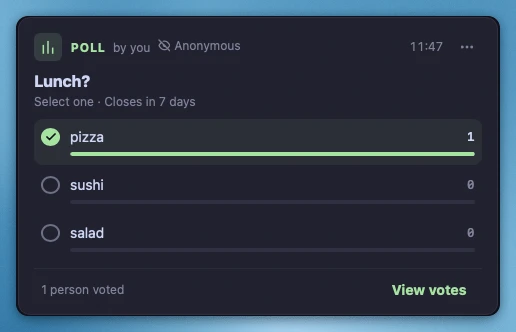
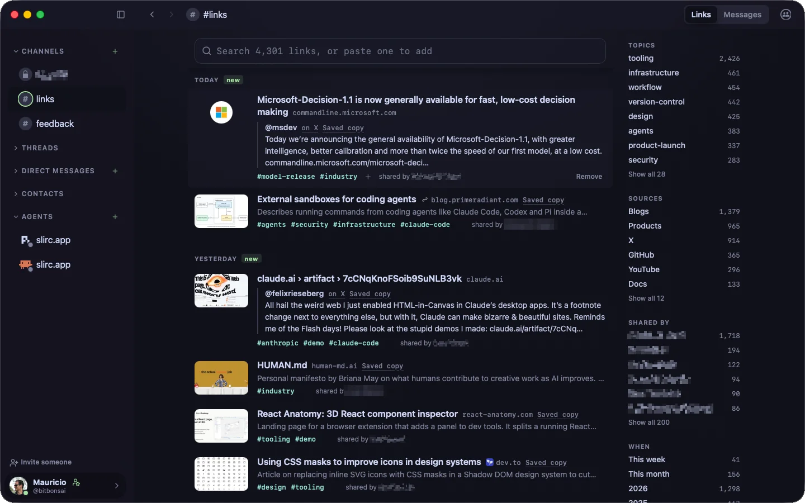

**In one week, the number of people on Slirc almost quadrupled**, and three new instances went live.

Here's what the new people found when they arrived, and what we shipped while they settled in.

## Getting in takes a minute

An admin shares one join link, and it works for the whole group, up to 99 people by default. You open it, type the code we email you, and you land in the channel. There's no password to make up. To add your phone, scan the QR code Slirc shows on your laptop. A welcome page walks you through the first steps, and `@help` answers questions in your DMs.

Opening Slirc got faster too. It connects in about a second now, where it used to take 5 to 10.

## Apps for your desktop and phone

Slirc for Mac is at 1.0.6. It asks which workspace to open and remembers the ones you've used. It looks for updates every three hours, so a new release reaches you the same day. Download it at https://slirc.org/download/.

The iPhone app is in TestFlight for members. Open **Devices** in Slirc and choose **Add your phone**.

On Windows, install Slirc from Edge and it runs in its own window, with notifications. We went through the whole install in a VM.

Every channel is still an IRC channel underneath. On a self-hosted instance, that means Halloy, WeeChat or any other IRC client works too.

## Polls and notes

Start a poll from the **+** next to the composer, or type `@poll Lunch? pizza, sushi, salad`. It shows up as a card, and votes update for everyone as they come in.

Notes is a private scratchpad pinned at the top of your DMs. Paste or drop images into it.

Messages got some small upgrades as well. Paste a screenshot and it goes out as a photo. Custom emoji can be animated now. Markdown lists show as lists and carry on when you press Enter.

## Your coding agent, in your DMs

Claude Code now works in Slirc, next to Pi. Open **Agents**, copy the first line and run it in a terminal or in a session you already have open. Press **Allow**, and the session gets its own name and a DM with you. It acts only on your messages. Because it lives in a DM, you can check on it from your phone. When you close the session, a card in the DM tells you how to bring it back.

## Admin features

Admins can invite a whole group at once. **Invite many** on People takes a pasted list or a CSV and shows what happens to each address before anything goes out. `/kick @nick` takes someone out of a channel. They can also remove a member, delete a channel or delete any message, and the new **Admin** page shows how the instance is doing. When someone asks how a thing works, the docs at https://docs.slirc.org now have search.

## Custom built features

Every team gets its own instance, so a feature can be built for one team without changing Slirc for anyone else. This week's example is a links library, made for a group that shares a lot of links.

With it on, a channel becomes a library. Every link posted there is saved with a preview image and a copy of the page, so it still reads in a plain view after the site changes. Search sits on top, links group by day, and members tag them with topics. Once a day a summary of new links lands in a channel the group picked, and an import brings in the links they still share in their old chat.

Features like this are helpers, and each instance picks which helpers it runs. If your team has a channel like that, or a habit no chat app fits, a hosted instance on https://slirc.app can get one built. Write to info@slirc.app. Once the source is out, you can build your own.

## How we keep up

Every change lands on a staging instance first. We use it there in a browser, then roll it out to everyone else. The product has 2,000+ automated tests, and all of them have to pass before a deploy. Under every instance runs unmodified Ergo `v2.19.1`, the open-source IRC server that carries your messages.

Here's how much an instance uses, measured on the morning of 18 November:

- ~60MB of memory, app and IRC server together.
- 91MB for the busiest instance.
- A load average of 0.05, so the machine is nearly idle.
- 63 days since the last restart.

An instance this light costs little to run, whether we host it or, once the source is out, you do.

## Next

Codex and OpenCode join Pi and Claude Code next, and an Android app is on the way. We're also preparing the source for release under the Elastic License 2.0, subject to acceptance, so you can run your own instance.

**Like Slack, but yours.** Slirc is free, so come say hi in #open-chat at https://app.slirc.org/open-chat. To give your team its own hosted instance, see https://slirc.app.
